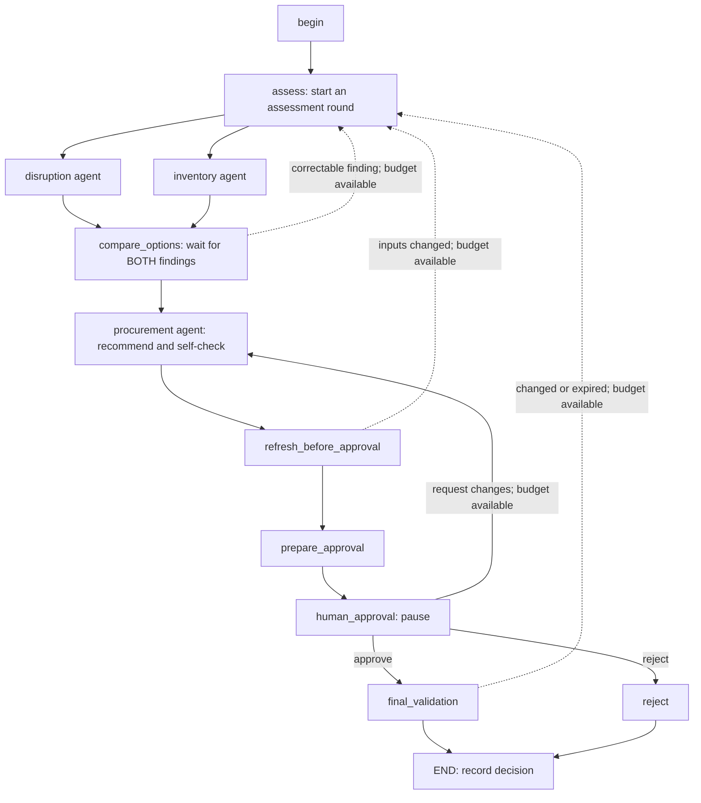

# DisruptOps

## Problem statement

Factories depend on incoming raw materials to fulfil production orders. When a supplier delays a shipment, the factory must decide whether existing stock can cover planned production or whether replacement material is worth the extra cost.

DisruptOps compares three choices: wait for the original delivery, buy enough to bridge the shortage, or buy extra to protect safety stock. Using synthetic factory and supplier data, it considers production schedules, bills of materials, stock, delivery dates, supplier offers and past incidents. It explains potential unmet demand, buffer depletion and additional spending so a human can choose an option with clear consequences.

## How this POC works

A delayed PO, factory numbers in SQLite, and a small supplier API on localhost. Three agents assess the case: disruption and inventory run in parallel, then procurement recommends an option. The run stops so you can approve, reject, or send it back. It does not place an order or change stock.

Needs Python 3.13.

## Walkthrough video

[Watch the DisruptOps walkthrough on YouTube](https://youtu.be/63Oiy-rx4bQ)

## Setup

```sh
python3.13 -m venv .venv
source .venv/bin/activate
python -m pip install -r requirements.txt
python -m pip install -e .
```

Put a key in `.env` at the repo root:

```
GOOGLE_API_KEY=your-key
```

`GEMINI_API_KEY` is accepted too. A key already set in the shell wins over `.env`.

Generate the synthetic factory database and supplier API fixture on a fresh clone:

```sh
python sqlite_supplier_poc/seed.py
```

The seed script will not overwrite an existing database. Generated databases, supplier payloads, local credentials and checkpoints are excluded from Git.

Incident rows are separate from the factory tables. Load them once:

```sh
python -m supply_chain_poc.integration --setup-incidents
```

## Run

Leave this running in one terminal:

```sh
python sqlite_supplier_poc/supplier_api.py
```

Default is http://127.0.0.1:8000. Change the port with `--port`, and match `supplier_api.base_url` in `config/agents.toml`.

See the prompts without calling the model:

```sh
python -m supply_chain_poc.integration
```

Price the wait / buy options from SQLite and the API, still no model:

```sh
python -m supply_chain_poc.integration --compare --format table
```

Start a case:

```sh
python -m supply_chain_poc.integration --run --thread-id case-001 --format table
```

Read it back later (no extra model call):

```sh
python -m supply_chain_poc.integration --status --thread-id case-001 --format table
```

Status prints a decision template. Save that JSON, fill in `approve`, `reject`, or `request_changes`, your name, and the option you picked. Approval needs `acknowledge_consequences` set to true. Reject has no option. `request_changes` needs a comment. Case, thread, snapshot, and comparison version have to match the status output.

```sh
python -m supply_chain_poc.integration --decision-file decision.json --thread-id case-001 --format table
```

One cheap connectivity check, no factory tools:

```sh
python -m supply_chain_poc.integration --smoke-test
```

Case ids and the planning date are in `examples/case_context.json`. Prompts, the model name, and tool lists are in `config/agents.toml`. Workflow state is written to `data/workflow.sqlite`.

## Workflow



The diagram shows the main flow and correction routes. Missing evidence, execution
failure or an exhausted revision budget ends at `escalate`; invalid human input leaves
the case paused. Correctable procurement output can retry procurement itself.

`assess` resets the two branch outputs. LangGraph executes `disruption` and `inventory`
in the same parallel step. Inventory reads supplier updates through its own tools, so
it does not need disruption's response. Each branch writes only its own outcome field.
The `add_edge(['disruption', 'inventory'], 'compare_options')` barrier waits for both.
`compare_options` merges the findings and lifecycle events, checks failures, computes
consequences and verifies both findings before procurement can run. Each live agent
has its own runtime/model client; repository connections are opened per query.

Procurement receives both findings and the calculated comparison. Its prompt asks it
to self-check every option, costs, buffer depletion and stress-scenario consequences.
Python still checks its snapshot, evidence and option references. The human can choose
any listed option. `reviewer_id` records the human operator's name.

One correction cycle is shared by machine and human revisions by default. An invalid
assessment or changed source data reruns BOTH assessment agents so the join receives
fresh findings. A procurement correction or human change request reruns procurement
only. Every correction increments the comparison version and invalidates the old choice.
Freshness checks before presentation and after approval remain in place.

The parallel graph is workflow version 2. Existing checkpoint records are preserved;
status can read them, but cases created by the older graph cannot be resumed under
this version. Start a new thread ID for a new parallel run.

## Verify without a Gemini key

```sh
PYTHONPATH=src python -W error::ResourceWarning -m unittest discover -s tests -v
```

The suite generates isolated SQLite databases and supplier fixtures; it does not need
an existing factory.sqlite, a Google key, or cloud inference. Local HTTP-server tests
exercise the same client as the application. Parallel tests use a synchronization
barrier to prove disruption and inventory overlap before procurement starts.

## Feature branches

| Branch | Scope |
|---|---|
| feature/core-shell | Abstract contracts, configuration and shell contract tests |
| feature/data-models | Typed findings, incident records and synthetic data generation |
| feature/tools | Read-only repositories, supplier HTTP tools, calculators and consequence checks |
| feature/subagents | Three concrete roles, prompt skills, Gemini runtime and scripted tool-loop tests |
| feature/integration | Parallel LangGraph, approval/resume, CLI and end-to-end regression tests |

These commits organize an existing POC into tested modules. Their timestamps reflect
repository preparation rather than the original development sessions.
